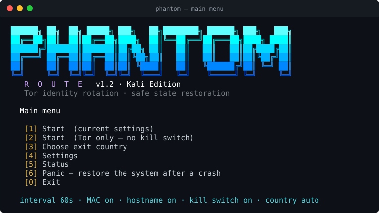
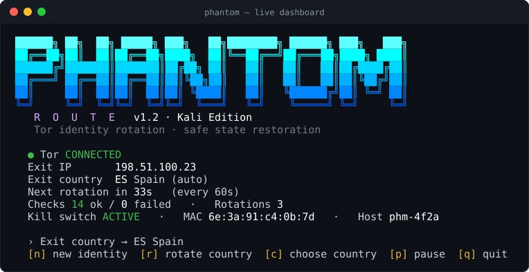

<p align="center">
  
</p>

<p align="center">
  
</p>

# 👻 PhantomRoute

🌐 **English** | [العربية](README.ar.md)

Rotate your network identity through **Tor** and get your system settings back exactly as they were when you stop.
Runs on **Kali / Debian / Ubuntu** (desktop) and on **Android via Termux**.

[](https://www.python.org/)
[](#-supported-platforms)

---

## 📋 Features

- 🖥️ **Interactive menu and live dashboard** in the terminal, with single-key shortcuts.
- 🖼️ **Desktop icon:** appears in the applications menu (and on your desktop) with the PhantomRoute logo, like other Kali tools.
- ⌨️ **Short commands:** just type `phantom` (or `phr`).
- 🌍 **Exit-country rotation:** picks an exit country geographically near your real one and rotates it on a timer (default 60 s).
- 🔒 **MAC address rotation** on the active interface (Kali edition).
- 🎭 **Random hostname** for the session (Kali edition).
- 🛡️ **Kill switch** using private iptables/ip6tables chains (`PHANTOMR_OUT`, `PHANTOMR_OUT6`). It never touches your other rules and lets out only loopback, DHCP and the Tor daemon itself (Kali edition).
- 🔐 **DNS routed to Tor's DNSPort** to prevent DNS leaks (Kali edition).
- 💾 **Original state saved** to `state.json` so `--panic` can restore everything after a crash or reboot.
- 🔑 **Tor control port protected** by a random per-session password.
- ⚡ **Country changes without restarting Tor** (through the control port), so circuits are not dropped.
- 📊 **Session report** with checks, rotations and countries used.

---

## 📱 Supported platforms

| Edition | Platform | Privileges | MAC | Kill switch | DNS |
|---|---|---|---|---|---|
| `PhantomRoute-Kali` | Kali / Debian / Ubuntu | root | ✅ | ✅ | ✅ |
| `PhantomRoute-Termux` | Android (Termux) | no root | ❌ | ❌ | limited |

---

## 📁 Project structure

```
PhantomRoute/
├── PhantomRoute-Kali/        # desktop edition
│   ├── phantomroute.py
│   ├── phantomroute.desktop  # application-menu entry
│   ├── icons/                # icon in all standard sizes
│   ├── install.sh
│   ├── uninstall.sh
│   └── README.md
├── PhantomRoute-Termux/      # Android edition
│   ├── phantomroute.py
│   ├── install.sh
│   └── README.md
├── assets/                   # logo, icon, screenshots, social-preview image
├── phantomroute              # optional universal launcher
├── README.md
├── README.ar.md
└── .gitignore
```

---

## ⬇️ Download

```bash
git clone https://github.com/Black-ghost7/PhantomRoute.git
cd PhantomRoute
```

Or use **Code → Download ZIP** on GitHub and extract it.

---

## 🛠️ Installation

### Kali / Debian / Ubuntu

```bash
cd PhantomRoute-Kali
chmod +x install.sh
./install.sh
```

The installer installs `tor curl macchanger iptables iproute2 python3`, copies the tool to `/usr/local/share/phantomroute` (root-owned) and creates the commands **`phantom`**, **`phr`** and `phantomroute` in `/usr/local/bin`. They all do the same thing; `sudo` is added for you.

It also installs the **icon and an application-menu entry**: search for *PhantomRoute* in your applications menu and click it to open the tool in a terminal. If your desktop folder exists, a shortcut is placed there too (if it shows a warning icon, right-click it → **Allow Launching** once).

### Android (Termux)

```bash
cd PhantomRoute-Termux
chmod +x install.sh
./install.sh
```

Android has no desktop-style application menu, so there is no icon entry for Termux. Install the free **Termux:Widget** app (F-Droid), add its widget to your home screen, and you get a one-tap **PhantomRoute** shortcut (the installer creates it).

### Universal launcher (optional)

`install.sh` already creates the `phantom`, `phr` and `phantomroute` commands. The universal launcher is only useful if you installed both editions on the same machine; it detects the platform and runs the right one:

```bash
chmod +x phantomroute
sudo cp phantomroute /usr/local/bin/        # on Termux: cp phantomroute $PREFIX/bin/
```

---

## 🚀 Usage

Just type the name:

```bash
phantom
```

(`phr` works too, and so does the full name `phantomroute`.) With no options you get the interactive menu:

<p align="center">
  
</p>

Choose **1** to start. While the tool is running you get a live dashboard:

<p align="center">
  
</p>

### Keyboard shortcuts (dashboard)

| Key | Action |
|---|---|
| `n` | New identity now (new Tor circuits, same country) |
| `r` | Rotate to a new random nearby country now |
| `c` | Choose the exit country yourself (Enter = back to automatic) |
| `p` | Pause / resume the automatic rotation timer |
| `q` | Quit safely — everything is restored |
| `Ctrl + C` | Same as `q` |

### Command-line mode

Any option skips the menu, which is handy for scripts:

```bash
phantom --start                 # start immediately with defaults
phantom --country DE            # fix the exit country
phantom --interval 30           # rotate every 30 seconds
phantom --no-mac                # skip MAC change
phantom --no-hostname           # skip hostname change
phantom --no-killswitch         # skip the kill switch
phantom --status                # show the saved state
phantom --panic                 # restore the system after a crash
```

> ⚠️ **Important:** PhantomRoute does **not** transparently route all system traffic through Tor. While the kill switch is on, every connection that does not go through Tor is blocked, so you must point your applications at **SOCKS5 `127.0.0.1:9050`** (e.g. your browser) or run them through `torsocks` / `proxychains`. Otherwise those applications will have no internet while the tool is running.
>
> Existing non-Tor connections (downloads, SSH, …) are **cut on purpose** when the kill switch starts, so they cannot leak your real address. Use `--no-killswitch` if you do not want this.

Press **q** or **Ctrl + C** (or close the terminal) at any time. The tool will automatically:

1. Remove its own kill-switch chains (only those).
2. Restore `resolv.conf` and `systemd-resolved`.
3. Stop Tor if it was not running before, and restore `torrc`.
4. Restore the original MAC address and hostname.
5. Verify that DNS and outbound connectivity work.

### Options

| Option | Description |
|---|---|
| `--start` | Start immediately (skip the menu) |
| `--country CC` | Fix the exit country (2-letter code, e.g. `DE`) |
| `--interval N` | Seconds between rotations (Kali: 60, Termux: 90; minimum 10) |
| `--no-mac` | Do not change the MAC address (Kali) |
| `--no-hostname` | Do not change the hostname (Kali) |
| `--no-killswitch` | Do not enable iptables rules (Kali) |
| `--status` | Print the contents of `state.json` |
| `--panic` | Run the emergency restoration |

### Using applications through Tor

```bash
torsocks curl https://check.torproject.org/api/ip
curl --socks5-hostname 127.0.0.1:9050 https://check.torproject.org/api/ip
proxychains4 firefox        # after setting proxychains to: socks5 127.0.0.1 9050
```

For Firefox: *Settings → Network Settings → Manual proxy*, set **SOCKS Host** `127.0.0.1`, **Port** `9050`, choose **SOCKS v5** and enable **Proxy DNS when using SOCKS v5**.

---

## 🆘 Recovering after a crash

If your internet is dead after the tool was killed (reboot, power loss, `kill -9`, …):

```bash
sudo phantom --panic
```

If that is not enough, remove the rules manually:

```bash
sudo iptables  -D OUTPUT -j PHANTOMR_OUT  && sudo iptables  -F PHANTOMR_OUT  && sudo iptables  -X PHANTOMR_OUT
sudo ip6tables -D OUTPUT -j PHANTOMR_OUT6 && sudo ip6tables -F PHANTOMR_OUT6 && sudo ip6tables -X PHANTOMR_OUT6
sudo systemctl restart systemd-resolved
sudo systemctl restart NetworkManager
```

---

## 🧪 Testing safely

Test inside a virtual machine first, with a snapshot and **NAT** networking (not bridged):

1. `phantom --start --no-mac --no-killswitch` and check `curl --socks5-hostname 127.0.0.1:9050 https://check.torproject.org/api/ip` returns `"IsTor":true`.
2. Stop with Ctrl + C and confirm `resolv.conf`, hostname and Tor are back to normal.
3. Add MAC/hostname changes, then the kill switch.
4. Run start/stop twice in a row.
5. Kill the process (`sudo pkill -9 -f phantomroute.py`) and recover with `--panic`.

---

## 📂 Files created by the tool

| Path | Purpose |
|---|---|
| `/var/lib/phantomroute/state.json` (Kali) | Original system state before the session |
| `~/.config/phantomroute/state.json` (Termux) | Original state before the session |
| `~/phantomroute_report.txt` | Session report |

---

## ⚠️ Limitations

- This tool does **not** guarantee anonymity. Browser fingerprinting, logging in to your own accounts and your behaviour online can identify you regardless of Tor.
- Restricting and frequently rotating exit countries may weaken Tor's usefulness for some use cases. Do not rely on it for high-risk threat models.
- Some websites block Tor exit nodes.
- Changing `iptables`, `resolv.conf` and the MAC address requires root and affects the whole machine while the tool runs.

---

## 📝 Changelog

**v1.2**
- New: interactive main menu (start, choose country, settings, status, panic).
- New: live dashboard with keyboard shortcuts (`n` `r` `c` `p` `q`).
- New: short commands `phantom` and `phr`; `--start`, `--country` and `--no-hostname` options.
- New: redesigned banner; screenshots in the README.
- New: logo, desktop icon and application-menu entry (Kali); Termux:Widget shortcut (Termux).
- Improvement: the dashboard adapts to narrow screens (phones).
- Security: the universal launcher no longer runs code from a user-writable folder as root.

**v1.1**
- Fix: the tool refused to start a second time after a clean stop.
- Fix: the kill switch blocked Tor itself; it now allows only the Tor user, loopback and DHCP, and also covers IPv6.
- Security: the Tor control port is now protected by a random per-session password instead of open access.
- Improvement: waits until Tor is actually working instead of a fixed `sleep`; country changes no longer restart Tor.
- Improvement: Tor and `torrc` are returned to their original state on exit; terminal close (SIGHUP) is handled.
- Improvement: the session report is actually written; restore state lives in the fixed path `/var/lib/phantomroute`.
- Install system-wide (`/usr/local`) so code running as root is never loaded from a user-writable folder.

---

## 🧯 Disclaimer

This tool is intended for **educational purposes and personal privacy/security testing only**, on systems and networks you own or are explicitly authorized to test.
The user is solely responsible for any illegal use. The author accepts no liability for damage resulting from misuse.

---

## 🤝 Contributing

Issues and pull requests are welcome.

## 👤 Author

**Black-ghost7** — [GitHub](https://github.com/Black-ghost7)
